# Esquema de Base de Datos SG-SST

## Diagrama Entidad-Relación (Mermaid)

```mermaid
erDiagram
    COMPANIES ||--o{ WORKERS : "tiene"
    COMPANIES ||--o{ USERS : "tiene"
    USERS ||--o{ ROLES : "tiene"
    WORKERS ||--o{ CONSENTS : "tiene"
    WORKERS ||--o{ WORKER_EXAMS : "tiene"
    WORKERS ||--o{ WORKER_CERTS : "tiene"
    WORKERS ||--o{ WORKER_EPP : "tiene"
    POLICIES ||--o{ OBJECTIVES : "tiene"
    HAZARD_CATALOG ||--o{ HAZARD_ASSESSMENTS : "referencia"
    STANDARDS ||--o{ STANDARD_ASSESSMENTS : "tiene"
    ANNUAL_PLAN ||--o{ PLAN_ACTIVITIES : "tiene"
    INDICATORS ||--o{ INDICATOR_VALUES : "tiene"

    COMPANIES {
        string id PK
        string nombre
        string nit UK
        string direccion
        string ciudad
        string telefono
        string email
        string canal_alertas
        datetime creado_en
        datetime actualizado_en
    }

    USERS {
        string id PK
        string email UK
        string nombre
        string hash
        string rol
        boolean activo
        datetime creado_en
        datetime actualizado_en
    }

    ROLES {
        string id PK
        string usuario_id FK
        string tipo
        string licencia_sst_numero
        date licencia_sst_vence
        date curso_50h_vence
        datetime creado_en
        datetime actualizado_en
    }

    WORKERS {
        string id PK
        string empresa_id FK
        string nombres
        string apellidos
        string documento
        string cargo
        string area
        date fecha_ingreso
        string estado
        string eps
        string arl
        string fondo_pensiones
        datetime creado_en
        datetime actualizado_en
    }

    CONSENTS {
        string id PK
        string worker_id FK
        string tipo
        boolean autorizado
        datetime fecha
        string ip
        string user_agent
    }

    WORKER_EXAMS {
        string id PK
        string worker_id FK
        string tipo
        date fecha
        date vencimiento
        string resultado
        string restricciones
        string medico
        string entidad
        string archivo_url
        string notas
    }

    WORKER_CERTS {
        string id PK
        string worker_id FK
        string tipo
        string nombre_curso
        string entidad
        date fecha_emision
        date fecha_vencimiento
        string archivo_url
        string notas
    }

    WORKER_EPP {
        string id PK
        string worker_id FK
        string item
        integer cantidad
        date fecha_entrega
        date fecha_vencimiento
        boolean firmado_por_trabajador
        string firma_url
        string notas
    }

    POLICIES {
        string id PK
        integer version
        string titulo
        text contenido
        string firmado_por
        date fecha_firma
        date fecha_divulgacion
        string estado
        datetime creado_en
        datetime actualizado_en
    }

    OBJECTIVES {
        string id PK
        string policy_id FK
        string descripcion
        string tipo
        string meta
        string responsable
        date fecha_limite
        string estado
    }

    HAZARD_CATALOG {
        string id PK
        string codigo
        string nombre
        string categoria
        string descripcion
        string riesgo_por_defecto
        string control_sugerido
        boolean activo
    }

    HAZARD_ASSESSMENTS {
        string id PK
        string cargo_oficio
        string area
        string peligro_id FK
        string peligro_texto
        string tarea
        string consecuencia
        string probabilidad
        string valoracion_riesgo
        string controles
        string responsable
        date fecha
        datetime revisado_en
        string estado
    }

    STANDARDS {
        string id PK
        string codigo
        string titulo
        string descripcion
        string set_aplicable
        string capitulo
        string modo_verificacion
        boolean activo
    }

    STANDARD_ASSESSMENTS {
        string id PK
        string standard_id FK
        boolean cumple
        string observaciones
        string plan_mejora
        datetime fecha
        string usuario_id
    }

    ANNUAL_PLAN {
        string id PK
        integer año
        string objetivo
        date fecha_inicio
        date fecha_fin
        string estado
        datetime creado_en
        datetime actualizado_en
    }

    PLAN_ACTIVITIES {
        string id PK
        string plan_id FK
        string descripcion
        string responsable
        date fecha_programada
        date fecha_real
        string estado
        string evidencia_url
    }

    INDICATORS {
        string id PK
        string codigo
        string nombre
        string descripcion
        string formula
        string frecuencia
        number meta
        string unidad
        string responsable
        boolean activo
    }

    INDICATOR_VALUES {
        string id PK
        string indicator_id FK
        string periodo
        number valor
        string observaciones
        string registrado_por
        datetime creado_en
    }

    INSPECTIONS {
        string id PK
        string tipo
        date fecha
        string area
        string responsable
        string estado
        string observaciones
        datetime creado_en
        datetime actualizado_en
    }

    INCIDENTS {
        string id PK
        string tipo
        date fecha
        string hora
        string lugar
        text descripcion
        string trabajador_id FK
        string testigos
        string lesion
        string parte_cuerpo
        string tipo_lesion
        string agente
        string mecanismo
        string estado
        string reportado_por
        datetime creado_en
        datetime actualizado_en
    }

    DOCUMENTS {
        string id PK
        string titulo
        string tipo
        text contenido
        integer version
        string estado
        date fecha_revision
        string aprobado_por
        datetime creado_en
        datetime actualizado_en
    }

    ACTIONS {
        string id PK
        string origen
        string origen_id
        string descripcion
        string causa_raiz
        string accion_correctiva
        string accion_preventiva
        string responsable
        date fecha_compromiso
        date fecha_cierre
        string estado
        string efectividad
    }

    AUDITS {
        string id PK
        string tipo
        date fecha_inicio
        date fecha_fin
        string alcance
        string auditor
        string criterio
        string estado
        string hallazgos
        string conclusiones
    }

    ALERTS {
        string id PK
        string entidad
        string entidad_id
        string tipo
        date fecha_vencimiento
        string prioridad
        boolean enviado
        datetime enviado_en
        string canal
        datetime creado_en
    }
```



---

## Tablas Detalladas

### 1. companies (Empresas)

| Campo          | Tipo | Constraints      | Descripción                     |
| -------------- | ---- | ---------------- | ------------------------------- |
| id             | TEXT | PK, NOT NULL     | UUID v4                         |
| nombre         | TEXT | NOT NULL         | Razón social                    |
| nit            | TEXT | NOT NULL, UNIQUE | NIT Colombia (900123456-7)      |
| direccion      | TEXT | NOT NULL         |                                 |
| ciudad         | TEXT | NOT NULL         |                                 |
| telefono       | TEXT |                  |                                 |
| email          | TEXT | NOT NULL         | Para alertas                    |
| canal_alertas  | TEXT | DEFAULT 'email'  | 'email' \| 'whatsapp' \| 'both' |
| creado_en      | TEXT | NOT NULL         | ISO 8601                        |
| actualizado_en | TEXT | NOT NULL         | ISO 8601                        |

**Índices**: `idx_companies_nit` (UNIQUE)

### 2. users (Usuarios Sistema)

| Campo          | Tipo    | Constraints      | Descripción                                              |
| -------------- | ------- | ---------------- | -------------------------------------------------------- |
| id             | TEXT    | PK, NOT NULL     | UUID v4                                                  |
| email          | TEXT    | NOT NULL, UNIQUE | Login                                                    |
| nombre         | TEXT    | NOT NULL         | Nombre completo                                          |
| hash           | TEXT    | NOT NULL         | bcrypt/argon2                                            |
| rol            | TEXT    | NOT NULL, CHECK  | 'admin' \| 'responsable_sst' \| 'supervisor' \| 'worker' |
| activo         | INTEGER | DEFAULT 1        | 0/1                                                      |
| creado_en      | TEXT    | NOT NULL         | ISO 8601                                                 |
| actualizado_en | TEXT    | NOT NULL         | ISO 8601                                                 |

### 3. roles (Roles SST)

| Campo               | Tipo | Constraints     | Descripción                                                        |
| ------------------- | ---- | --------------- | ------------------------------------------------------------------ |
| id                  | TEXT | PK, NOT NULL    | UUID v4                                                            |
| usuario_id          | TEXT | FK → users.id   |                                                                    |
| tipo                | TEXT | NOT NULL, CHECK | 'responsable_sst' \| 'copasst' \| 'brigadista' \| 'supervisor_sst' |
| licencia_sst_numero | TEXT |                 | Número resolución                                                  |
| licencia_sst_vence  | TEXT |                 | YYYY-MM-DD                                                         |
| curso_50h_vence     | TEXT |                 | YYYY-MM-DD                                                         |
| creado_en           | TEXT | NOT NULL        | ISO 8601                                                           |
| actualizado_en      | TEXT | NOT NULL        | ISO 8601                                                           |

**Índices**: `idx_roles_usuario` (usuario_id)

### 4. workers (Trabajadores)

| Campo           | Tipo | Constraints                 | Descripción                                          |
| --------------- | ---- | --------------------------- | ---------------------------------------------------- |
| id              | TEXT | PK, NOT NULL                | UUID v4                                              |
| empresa_id      | TEXT | FK → companies.id, NOT NULL |                                                      |
| nombres         | TEXT | NOT NULL                    |                                                      |
| apellidos       | TEXT | NOT NULL                    |                                                      |
| documento       | TEXT | NOT NULL                    | CC, NIT, CE, TI                                      |
| cargo           | TEXT | NOT NULL                    | Ej: Electricista, Soldador                           |
| area            | TEXT |                             | Ej: Mantenimiento, Producción                        |
| fecha_ingreso   | TEXT | NOT NULL                    | YYYY-MM-DD                                           |
| estado          | TEXT | DEFAULT 'activo', CHECK     | 'activo' \| 'inactivo' \| 'retirado' \| 'suspendido' |
| eps             | TEXT |                             | Entidad promotora de salud                           |
| arl             | TEXT |                             | Administradora riesgos laborales                     |
| fondo_pensiones | TEXT |                             | AFP                                                  |
| creado_en       | TEXT | NOT NULL                    | ISO 8601                                             |
| actualizado_en  | TEXT | NOT NULL                    | ISO 8601                                             |

**Índices**: `idx_workers_empresa` (empresa_id), `idx_workers_documento` (documento), `idx_workers_estado` (estado)

### 5. consents (Consentimientos Ley 1581/2012)

| Campo      | Tipo    | Constraints               | Descripción                                    |
| ---------- | ------- | ------------------------- | ---------------------------------------------- |
| id         | TEXT    | PK, NOT NULL              | UUID v4                                        |
| worker_id  | TEXT    | FK → workers.id, NOT NULL |                                                |
| tipo       | TEXT    | NOT NULL, CHECK           | 'medico' \| 'datos_personales' \| 'foto_video' |
| autorizado | INTEGER | NOT NULL, CHECK           | 0 \| 1                                         |
| fecha      | TEXT    | NOT NULL                  | ISO 8601                                       |
| ip         | TEXT    |                           | IP cliente                                     |
| user_agent | TEXT    |                           | User agent                                     |

**Índices**: `idx_consents_worker_tipo` (worker_id, tipo) UNIQUE

### 6. worker_exams (Exámenes Médicos)

| Campo         | Tipo | Constraints               | Descripción                                       |
| ------------- | ---- | ------------------------- | ------------------------------------------------- |
| id            | TEXT | PK, NOT NULL              | UUID v4                                           |
| worker_id     | TEXT | FK → workers.id, NOT NULL |                                                   |
| tipo          | TEXT | NOT NULL, CHECK           | 'ingreso' \| 'periodico' \| 'egreso' \| 'control' |
| fecha         | TEXT | NOT NULL                  | YYYY-MM-DD                                        |
| vencimiento   | TEXT |                           | YYYY-MM-DD                                        |
| resultado     | TEXT | DEFAULT 'apto', CHECK     | 'apto' \| 'apto_con_restricciones' \| 'no_apto'   |
| restricciones | TEXT |                           | Sensible - Ley 1581                               |
| medico        | TEXT |                           | Nombre médico                                     |
| entidad       | TEXT |                           | Clínica/IPS                                       |
| archivo_url   | TEXT |                           | Ruta archivo PDF                                  |
| notas         | TEXT |                           |                                                   |

**Índices**: `idx_worker_exams_worker` (worker_id), `idx_worker_exams_vencimiento` (vencimiento), `idx_worker_exams_tipo` (tipo)

**Reglas Negocio**: UNIQUE(worker_id, tipo='ingreso') - Solo un examen de ingreso.

### 7. worker_certs (Certificados)

| Campo             | Tipo | Constraints               | Descripción                                                                                         |
| ----------------- | ---- | ------------------------- | --------------------------------------------------------------------------------------------------- |
| id                | TEXT | PK, NOT NULL              | UUID v4                                                                                             |
| worker_id         | TEXT | FK → workers.id, NOT NULL |                                                                                                     |
| tipo              | TEXT | NOT NULL, CHECK           | 'alturas' \| 'electrico' \| 'primeros_auxilios' \| 'brigada' \| 'conduccion' \| 'sst_50h' \| 'otro' |
| nombre_curso      | TEXT |                           |                                                                                                     |
| entidad           | TEXT |                           | Entidad certificadora                                                                               |
| fecha_emision     | TEXT | NOT NULL                  | YYYY-MM-DD                                                                                          |
| fecha_vencimiento | TEXT | NOT NULL                  | YYYY-MM-DD                                                                                          |
| archivo_url       | TEXT |                           | Ruta archivo                                                                                        |
| notas             | TEXT |                           |                                                                                                     |

**Índices**: `idx_worker_certs_worker` (worker_id), `idx_worker_certs_vencimiento` (fecha_vencimiento), `idx_worker_certs_tipo` (tipo)

**Regla Res. 4272/2021 Art. 12**: Si tipo='alturas' → fecha_vencimiento = fecha_emision + 3 años exactos.

### 8. worker_epp (Entrega EPP)

| Campo                  | Tipo    | Constraints               | Descripción      |
| ---------------------- | ------- | ------------------------- | ---------------- |
| id                     | TEXT    | PK, NOT NULL              | UUID v4          |
| worker_id              | TEXT    | FK → workers.id, NOT NULL |                  |
| item                   | TEXT    | NOT NULL                  | Nombre EPP       |
| cantidad               | INTEGER | DEFAULT 1                 |                  |
| fecha_entrega          | TEXT    | NOT NULL                  | YYYY-MM-DD       |
| fecha_vencimiento      | TEXT    |                           | YYYY-MM-DD       |
| firmado_por_trabajador | INTEGER | DEFAULT 0                 | 0 \| 1           |
| firma_url              | TEXT    |                           | Base64 PNG firma |
| notas                  | TEXT    |                           |                  |

**Índices**: `idx_worker_epp_worker` (worker_id), `idx_worker_epp_vencimiento` (fecha_vencimiento), `idx_worker_epp_firmado` (firmado_por_trabajador)

### 9. policies (Política SST)

| Campo             | Tipo    | Constraints               | Descripción                            |
| ----------------- | ------- | ------------------------- | -------------------------------------- |
| id                | TEXT    | PK, NOT NULL              | UUID v4                                |
| version           | INTEGER | NOT NULL                  | Incremental                            |
| titulo            | TEXT    | NOT NULL                  |                                        |
| contenido         | TEXT    | NOT NULL                  | Texto completo                         |
| firmado_por       | TEXT    |                           | Nombre firmante                        |
| fecha_firma       | TEXT    |                           | YYYY-MM-DD                             |
| fecha_divulgacion | TEXT    |                           | YYYY-MM-DD                             |
| estado            | TEXT    | DEFAULT 'borrador', CHECK | 'borrador' \| 'vigente' \| 'archivada' |
| creado_en         | TEXT    | NOT NULL                  | ISO 8601                               |
| actualizado_en    | TEXT    | NOT NULL                  | ISO 8601                               |

**Regla**: Solo UNA política con estado='vigente' a la vez.

### 10. objectives (Objetivos Política)

| Campo        | Tipo | Constraints                | Descripción                                               |
| ------------ | ---- | -------------------------- | --------------------------------------------------------- |
| id           | TEXT | PK, NOT NULL               | UUID v4                                                   |
| policy_id    | TEXT | FK → policies.id, NOT NULL |                                                           |
| descripcion  | TEXT | NOT NULL                   |                                                           |
| tipo         | TEXT | NOT NULL, CHECK            | 'estructura' \| 'proceso' \| 'resultado'                  |
| meta         | TEXT |                            | Meta cuantitativa                                         |
| responsable  | TEXT |                            |                                                           |
| fecha_limite | TEXT |                            | YYYY-MM-DD                                                |
| estado       | TEXT | DEFAULT 'pendiente', CHECK | 'pendiente' \| 'cumplido' \| 'en_proceso' \| 'incumplido' |

### 11. hazard_catalog (Catálogo Peligros IPERC)

| Campo              | Tipo    | Constraints            | Descripción                              |
| ------------------ | ------- | ---------------------- | ---------------------------------------- |
| id                 | TEXT    | PK, NOT NULL           | UUID v4                                  |
| codigo             | TEXT    | NOT NULL, UNIQUE       | Ej: EL-001, AL-001                       |
| nombre             | TEXT    | NOT NULL               |                                          |
| categoria          | TEXT    | NOT NULL, CHECK        | 10 categorías válidas                    |
| descripcion        | TEXT    |                        |                                          |
| riesgo_por_defecto | TEXT    | DEFAULT 'medio', CHECK | 'bajo' \| 'medio' \| 'alto' \| 'critico' |
| control_sugerido   | TEXT    |                        |                                          |
| activo             | INTEGER | DEFAULT 1              | 0 \| 1 (soft delete)                     |

**Índices**: `idx_hazard_catalog_categoria` (categoria), `idx_hazard_catalog_activo` (activo)

### 12. hazard_assessments (Evaluaciones IPERC)

| Campo             | Tipo | Constraints              | Descripción                              |
| ----------------- | ---- | ------------------------ | ---------------------------------------- |
| id                | TEXT | PK, NOT NULL             | UUID v4                                  |
| cargo_oficio      | TEXT | NOT NULL                 | Ej: Electricista, Trabajador alturas     |
| area              | TEXT |                          |                                          |
| peligro_id        | TEXT | FK → hazard_catalog.id   | Opcional (catálogo)                      |
| peligro_texto     | TEXT |                          | Peligro descripción libre                |
| tarea             | TEXT |                          |                                          |
| consecuencia      | TEXT |                          |                                          |
| probabilidad      | TEXT |                          |                                          |
| valoracion_riesgo | TEXT | DEFAULT 'medio', CHECK   | 'bajo' \| 'medio' \| 'alto' \| 'critico' |
| controles         | TEXT |                          | Medidas de control                       |
| responsable       | TEXT |                          |                                          |
| fecha             | TEXT | NOT NULL                 | YYYY-MM-DD                               |
| revisado_en       | TEXT |                          | ISO 8601 (auto en update)                |
| estado            | TEXT | DEFAULT 'vigente', CHECK | 'vigente' \| 'revisado' \| 'obsoleto'    |

### 13. standards (Estándares Normativos)

| Campo             | Tipo    | Constraints     | Descripción                                                 |
| ----------------- | ------- | --------------- | ----------------------------------------------------------- |
| id                | TEXT    | PK, NOT NULL    | UUID v4                                                     |
| codigo            | TEXT    | NOT NULL        | Ej: ISO-45001-4.1, RES-0312-10                              |
| titulo            | TEXT    | NOT NULL        |                                                             |
| descripcion       | TEXT    |                 |                                                             |
| set_aplicable     | TEXT    | NOT NULL, CHECK | 'iso45001' \| 'resoluciones_colombia' \| 'otro'             |
| capitulo          | TEXT    |                 | Ej: '4. Contexto', 'Res. 0312'                              |
| modo_verificacion | TEXT    | CHECK           | 'documental' \| 'entrevista' \| 'observacion' \| 'medicion' |
| activo            | INTEGER | DEFAULT 1       | 0 \| 1                                                      |

### 14. standard_assessments (Evaluaciones Estándares)

| Campo         | Tipo    | Constraints                 | Descripción  |
| ------------- | ------- | --------------------------- | ------------ |
| id            | TEXT    | PK, NOT NULL                | UUID v4      |
| standard_id   | TEXT    | FK → standards.id, NOT NULL |              |
| cumple        | INTEGER | NOT NULL, CHECK             | 0 \| 1       |
| observaciones | TEXT    |                             |              |
| plan_mejora   | TEXT    |                             | Si no cumple |
| fecha         | TEXT    | NOT NULL                    | ISO 8601     |
| usuario_id    | TEXT    | FK → users.id               | Quién evaluó |

### 15. annual_plan (Plan Anual Trabajo)

| Campo          | Tipo    | Constraints                | Descripción                                                |
| -------------- | ------- | -------------------------- | ---------------------------------------------------------- |
| id             | TEXT    | PK, NOT NULL               | UUID v4                                                    |
| año            | INTEGER | NOT NULL                   | Ej: 2026                                                   |
| objetivo       | TEXT    | NOT NULL                   | Objetivo general                                           |
| fecha_inicio   | TEXT    | NOT NULL                   | YYYY-MM-DD                                                 |
| fecha_fin      | TEXT    | NOT NULL                   | YYYY-MM-DD                                                 |
| estado         | TEXT    | DEFAULT 'pendiente', CHECK | 'pendiente' \| 'en_proceso' \| 'cumplido' \| 'no_cumplido' |
| creado_en      | TEXT    | NOT NULL                   | ISO 8601                                                   |
| actualizado_en | TEXT    | NOT NULL                   | ISO 8601                                                   |

### 16. plan_activities (Actividades Plan)

| Campo            | Tipo | Constraints                   | Descripción                                                |
| ---------------- | ---- | ----------------------------- | ---------------------------------------------------------- |
| id               | TEXT | PK, NOT NULL                  | UUID v4                                                    |
| plan_id          | TEXT | FK → annual_plan.id, NOT NULL |                                                            |
| descripcion      | TEXT | NOT NULL                      |                                                            |
| responsable      | TEXT |                               |                                                            |
| fecha_programada | TEXT |                               | YYYY-MM-DD                                                 |
| fecha_real       | TEXT |                               | YYYY-MM-DD                                                 |
| estado           | TEXT | DEFAULT 'pendiente', CHECK    | 'pendiente' \| 'en_proceso' \| 'cumplido' \| 'no_cumplido' |
| evidencia_url    | TEXT |                               | Archivo evidencia                                          |

### 17. indicators (Indicadores KPI)

| Campo       | Tipo    | Constraints      | Descripción                                         |
| ----------- | ------- | ---------------- | --------------------------------------------------- |
| id          | TEXT    | PK, NOT NULL     | UUID v4                                             |
| codigo      | TEXT    | NOT NULL, UNIQUE | Ej: TRIR, LTIFR                                     |
| nombre      | TEXT    | NOT NULL         |                                                     |
| descripcion | TEXT    |                  |                                                     |
| formula     | TEXT    |                  | Fórmula cálculo                                     |
| frecuencia  | TEXT    | CHECK            | 'mensual' \| 'trimestral' \| 'semestral' \| 'anual' |
| meta        | REAL    | NOT NULL         | Valor objetivo                                      |
| unidad      | TEXT    | NOT NULL         | Ej: 'x100k hrs', '%'                                |
| responsable | TEXT    |                  |                                                     |
| activo      | INTEGER | DEFAULT 1        | 0 \| 1                                              |

### 18. indicator_values (Valores Históricos)

| Campo          | Tipo | Constraints                  | Descripción    |
| -------------- | ---- | ---------------------------- | -------------- |
| id             | TEXT | PK, NOT NULL                 | UUID v4        |
| indicator_id   | TEXT | FK → indicators.id, NOT NULL |                |
| periodo        | TEXT | NOT NULL                     | YYYY-MM o YYYY |
| valor          | REAL | NOT NULL                     | Valor medido   |
| observaciones  | TEXT |                              |                |
| registrado_por | TEXT | FK → users.id                |                |
| creado_en      | TEXT | NOT NULL                     | ISO 8601       |

### 19. inspections (Inspecciones)

| Campo          | Tipo | Constraints                | Descripción                                                                     |
| -------------- | ---- | -------------------------- | ------------------------------------------------------------------------------- |
| id             | TEXT | PK, NOT NULL               | UUID v4                                                                         |
| tipo           | TEXT | NOT NULL, CHECK            | 'periodica' \| 'pre_operacional' \| 'post_incidente' \| 'alturas' \| 'especial' |
| fecha          | TEXT | NOT NULL                   | YYYY-MM-DD                                                                      |
| area           | TEXT |                            |                                                                                 |
| responsable    | TEXT |                            |                                                                                 |
| estado         | TEXT | DEFAULT 'pendiente', CHECK | 'pendiente' \| 'programada' \| 'en_proceso' \| 'completada' \| 'cancelada'      |
| observaciones  | TEXT |                            |                                                                                 |
| creado_en      | TEXT | NOT NULL                   | ISO 8601                                                                        |
| actualizado_en | TEXT | NOT NULL                   | ISO 8601                                                                        |

### 20. incidents (Incidentes/Accidentes)

| Campo          | Tipo | Constraints                | Descripción                                                                                                                |
| -------------- | ---- | -------------------------- | -------------------------------------------------------------------------------------------------------------------------- |
| id             | TEXT | PK, NOT NULL               | UUID v4                                                                                                                    |
| tipo           | TEXT | NOT NULL, CHECK            | 'accidente_trabajo' \| 'incidente_sin_baja' \| 'enfermedad_laboral' \| 'casi_accidente' \| 'daño_propiedad' \| 'ambiental' |
| fecha          | TEXT | NOT NULL                   | YYYY-MM-DD                                                                                                                 |
| hora           | TEXT | NOT NULL                   | HH:MM                                                                                                                      |
| lugar          | TEXT | NOT NULL                   |                                                                                                                            |
| descripcion    | TEXT | NOT NULL                   |                                                                                                                            |
| trabajador_id  | TEXT | FK → workers.id            | Si aplica                                                                                                                  |
| testigos       | TEXT |                            |                                                                                                                            |
| lesion         | TEXT |                            | Naturaleza lesión                                                                                                          |
| parte_cuerpo   | TEXT |                            | Parte afectada                                                                                                             |
| tipo_lesion    | TEXT |                            | Tipo (fractura, quemadura, etc.)                                                                                           |
| agente         | TEXT |                            | Agente causal                                                                                                              |
| mecanismo      | TEXT |                            | Mecanismo lesión                                                                                                           |
| estado         | TEXT | DEFAULT 'reportado', CHECK | 'reportado' \| 'en_investigacion' \| 'cerrado' \| 'archivado'                                                              |
| reportado_por  | TEXT | NOT NULL                   | Usuario ID                                                                                                                 |
| creado_en      | TEXT | NOT NULL                   | ISO 8601                                                                                                                   |
| actualizado_en | TEXT | NOT NULL                   | ISO 8601                                                                                                                   |

### 21. documents (Documentos SG-SST)

| Campo          | Tipo    | Constraints               | Descripción                                                                         |
| -------------- | ------- | ------------------------- | ----------------------------------------------------------------------------------- |
| id             | TEXT    | PK, NOT NULL              | UUID v4                                                                             |
| titulo         | TEXT    | NOT NULL                  |                                                                                     |
| tipo           | TEXT    | CHECK                     | 'politica' \| 'procedimiento' \| 'instructivo' \| 'formato' \| 'registro' \| 'otro' |
| contenido      | TEXT    |                           | Texto/referencia                                                                    |
| version        | INTEGER | DEFAULT 1                 |                                                                                     |
| estado         | TEXT    | DEFAULT 'borrador', CHECK | 'borrador' \| 'en_revision' \| 'aprobado' \| 'vigente' \| 'obsoleto'                |
| fecha_revision | TEXT    |                           | YYYY-MM-DD (próxima revisión)                                                       |
| aprobado_por   | TEXT    |                           | Usuario ID                                                                          |
| creado_en      | TEXT    | NOT NULL                  | ISO 8601                                                                            |
| actualizado_en | TEXT    | NOT NULL                  | ISO 8601                                                                            |

### 22. actions (Acciones Correctivas/Preventivas)

| Campo             | Tipo | Constraints              | Descripción                                                                   |
| ----------------- | ---- | ------------------------ | ----------------------------------------------------------------------------- |
| id                | TEXT | PK, NOT NULL             | UUID v4                                                                       |
| origen            | TEXT | CHECK                    | 'incidente' \| 'inspeccion' \| 'auditoria' \| 'hallazgo' \| 'queja' \| 'otro' |
| origen_id         | TEXT |                          | ID referencia                                                                 |
| descripcion       | TEXT | NOT NULL                 |                                                                               |
| causa_raiz        | TEXT |                          | Análisis causa raíz                                                           |
| accion_correctiva | TEXT |                          | Inmediata                                                                     |
| accion_preventiva | TEXT |                          | Sistémica                                                                     |
| responsable       | TEXT | NOT NULL                 | Usuario ID                                                                    |
| fecha_compromiso  | TEXT | NOT NULL                 | YYYY-MM-DD                                                                    |
| fecha_cierre      | TEXT |                          | YYYY-MM-DD                                                                    |
| estado            | TEXT | DEFAULT 'abierta', CHECK | 'abierta' \| 'en_proceso' \| 'verificacion' \| 'cerrada' \| 'cancelada'       |
| efectividad       | TEXT | CHECK                    | 'pendiente' \| 'efectiva' \| 'no_efectiva'                                    |

### 23. audits (Auditorías)

| Campo        | Tipo | Constraints                  | Descripción                                                |
| ------------ | ---- | ---------------------------- | ---------------------------------------------------------- |
| id           | TEXT | PK, NOT NULL                 | UUID v4                                                    |
| tipo         | TEXT | CHECK                        | 'interna' \| 'externa' \| 'certificacion' \| 'proveedor'   |
| fecha_inicio | TEXT | NOT NULL                     | YYYY-MM-DD                                                 |
| fecha_fin    | TEXT |                              | YYYY-MM-DD                                                 |
| alcance      | TEXT | NOT NULL                     |                                                            |
| auditor      | TEXT | NOT NULL                     | Nombre auditor                                             |
| criterio     | TEXT | NOT NULL                     | Ej: 'ISO 45001:2018'                                       |
| estado       | TEXT | DEFAULT 'planificada', CHECK | 'planificada' \| 'en_proceso' \| 'finalizada' \| 'cerrada' |
| hallazgos    | TEXT |                              |                                                            |
| conclusiones | TEXT |                              |                                                            |

### 24. alerts (Alertas Automáticas)

| Campo             | Tipo    | Constraints     | Descripción                                                                                         |
| ----------------- | ------- | --------------- | --------------------------------------------------------------------------------------------------- |
| id                | TEXT    | PK, NOT NULL    | UUID v4                                                                                             |
| entidad           | TEXT    | NOT NULL        | Tabla origen                                                                                        |
| entidad_id        | TEXT    | NOT NULL        | PK registro origen                                                                                  |
| tipo              | TEXT    | CHECK           | 'examen' \| 'certificado' \| 'licencia_sst' \| 'curso_50h' \| 'inspeccion' \| 'plan' \| 'documento' |
| fecha_vencimiento | TEXT    | NOT NULL        | YYYY-MM-DD                                                                                          |
| prioridad         | TEXT    | CHECK           | 'critica' \| 'alta' \| 'media'                                                                      |
| enviado           | INTEGER | DEFAULT 0       | 0 \| 1                                                                                              |
| enviado_en        | TEXT    |                 | ISO 8601                                                                                            |
| canal             | TEXT    | DEFAULT 'email' | 'email' \| 'whatsapp' \| 'both'                                                                     |
| creado_en         | TEXT    | NOT NULL        | ISO 8601                                                                                            |

**Índices**: `idx_alerts_tipo` (tipo), `idx_alerts_fecha_vencimiento` (fecha_vencimiento), `idx_alerts_enviado` (enviado), `idx_alerts_entidad` (entidad, entidad_id)

---

## Migraciones

### 001_initial.sql

Migración completa que crea todas las 24 tablas, índices, triggers y datos semilla (catálogo peligros, estándares ISO 45001 + Resoluciones Colombia, empresa demo, usuario admin).

**Ejecución**:

```bash
# Desarrollo
pnpm -w server run seed

# Reset completo (borra y recrea)
pnpm -w server run reset
```

**Ubicación**: `server/src/migrations/001_initial.sql` (copiado a `dist/lib/migrations/` en build)

---

## Seed Data (Datos Iniciales)

### Catálogo de Peligros (~30 items)

Categorías: alturas, electrico, herramientas, escaleras, ergonomia, conduccion, cielos_rasos, confinados, locativo, otro

- Basado en matriz IPERC típica instalaciones eléctricas
- Códigos estandarizados (EL-XXX, AL-XXX, HE-XXX, ES-XXX, ER-XXX, CO-XXX, CR-XXX, CF-XXX, LO-XXX, OT-XXX)

### Estándares (~120 items)

- **ISO 45001:2018**: Cláusulas 4-10 (~60 requisitos)
- **Resoluciones Colombia**: 0312/2019, 1016/1989, 2400/1979, 4272/2021, 5018/2019, Decreto 1072/2015 (~60 items)

### Empresa Demo

- **NIT**: 900123456-7
- **Nombre**: Instalaciones Eléctricas SAS
- **Ciudad**: Bogotá

### Usuario Admin Demo

- **Email**: admin@sg-sst.local
- **Rol**: admin
- **Password**: (generado en seed, ver logs)

### Responsable SST Demo

- Usuario con rol 'responsable_sst'
- Licencia SST y Curso 50h con vigencias futuras

---

## Consultas Útiles

```sql
-- Trabajadores con exámenes por vencer (30 días)
SELECT w.nombres, w.apellidos, w.cargo, we.tipo, we.vencimiento,
       julianday(we.vencimiento) - julianday('now') as dias_restantes
FROM workers w
JOIN worker_exams we ON we.worker_id = w.id
WHERE we.vencimiento IS NOT NULL
  AND we.vencimiento <= date('now', '+30 days')
  AND w.estado = 'activo'
ORDER BY we.vencimiento;

-- Certificados alturas con vigencia incorrecta
SELECT wc.*, w.nombres, w.apellidos,
       date(wc.fecha_emision, '+3 years') as vencimiento_esperado
FROM worker_certs wc
JOIN workers w ON w.id = wc.worker_id
WHERE wc.tipo = 'alturas'
  AND wc.fecha_vencimiento != date(wc.fecha_emision, '+3 years');

-- Alertas pendientes por tipo
SELECT tipo, prioridad, COUNT(*) as total
FROM alerts
WHERE enviado = 0
GROUP BY tipo, prioridad
ORDER BY
  CASE prioridad WHEN 'critica' THEN 1 WHEN 'alta' THEN 2 ELSE 3 END;

-- Cumplimiento estándares por set
SELECT s.set_aplicable,
       COUNT(sa.id) as total_evaluados,
       SUM(sa.cumple) as cumplidos,
       ROUND(100.0 * SUM(sa.cumple) / COUNT(sa.id), 1) as porcentaje
FROM standards s
LEFT JOIN standard_assessments sa ON sa.standard_id = s.id
WHERE s.activo = 1
GROUP BY s.set_aplicable;
```

---

## Backup y Restore

### Backup (SQLite archivo único)

```bash
# Copia simple (consistente con WAL checkpoint)
cp data/sg-sst.db backups/sg-sst-$(date +%Y%m%d-%H%M%S).db

# Con sqlite3 CLI (backup online)
sqlite3 data/sg-sst.db ".backup backups/sg-sst-$(date +%Y%m%d).db"

# Export SQL
sqlite3 data/sg-sst.db .dump > backups/sg-sst-$(date +%Y%m%d).sql
```

### Restore

```bash
# Desde archivo .db
cp backups/sg-sst-20260115.db data/sg-sst.db

# Desde SQL dump
sqlite3 data/sg-sst.db < backups/sg-sst-20260115.sql
```

### Automatizado (cron/daily)

Ver `server/src/lib/scheduler.ts` - incluye backup diario compresado.

---

## Backup y Restore PostgreSQL (Neon)

El respaldo lógico portable vive en `server/src/services/backup.pg.ts` y no
requiere `pg_dump` ni `psql`. Genera un directorio por corrida con un
`MANIFEST.json` y un `.jsonl.gz` por tabla.

### Crear backup

```bash
# Valida la conexión y escribe en BACKUP_DIR (default: ./backups)
pnpm --dir server run backup:pg -- --url-env DATABASE_URL_DEV

# Directorio alterno
pnpm --dir server run backup:pg -- --url-env DATABASE_URL_DEV --backup-dir /ruta/backups
```

Cada corrida produce `sg-sst-pg-backup-<timestamp>/` con: manifiesto
(`backend`, `format`, migraciones aplicadas, orden de dependencias, conteos y
SHA-256 por tabla), datos JSONL comprimidos y, si existe, copia de `uploads`.
El nombre `sg-sst-pg-backup-*` es el que usa la retención
(`BACKUP_RETENTION_DAYS`, default 30).

### Validar sin escribir

```bash
pnpm --dir server run restore:pg -- --url-env DATABASE_URL_DEV \
  --dir sg-sst-pg-backup-2026-11-13T21-20-32
```

Verifica nombre seguro, manifiesto, checksum y conteo de filas de cada tabla.
No toca el destino; es el paso recomendado antes de un `--apply`.

### Restaurar

```bash
pnpm --dir server run restore:pg -- --url-env DATABASE_URL_DEV \
  --dir sg-sst-pg-backup-2026-11-13T21-20-32 --apply
```

La restauración valida el backup, exige que el destino tenga las mismas
migraciones o superiores (`pnpm --dir server run migrate:pg`), abre una
transacción, hace `TRUNCATE ... CASCADE` de las tablas del manifiesto, inserta
por lotes, compara conteos y recién entonces confirma. Si algo falla, hace
rollback y no deja el destino a medias. Con `--dir` se restaura un backup
puntual; sin `--dir` se usa el más reciente.

En `NODE_ENV=production` el script se niega a escribir salvo `--allow-production`.
No se debe restaurar sobre producción sin aprobación explícita de la empresa y
con el servidor detenido.

### Limitaciones y complementos

- Es **solo datos**: no recrea el esquema. Un destino vacío debe migrarse antes.
- No reemplaza un respaldo físico para volúmenes grandes; para eso use
  `pg_dump`/`pg_restore` o las ramas de Neon.
- En Neon, una rama (branch) o el point-in-time restore son el complemento
  recomendado para recuperación ante desastres. El backup lógico sirve para
  auditoría, traslado entre entornos y restauración selectiva.
- Tras restaurar, verifique login, una empresa, un examen con campos cifrados y
  la descarga de un archivo de `uploads`.

---

## Performance Tips

1. **WAL Mode**: Habilitado por defecto (`PRAGMA journal_mode=WAL`)
2. **Índices**: Creados en migración para FK y columnas de filtro frecuente
3. **Consultas**: Usar `EXPLAIN QUERY PLAN` para verificar uso de índices
4. **Paginación**: Siempre usar LIMIT/OFFSET en listados grandes
5. **Conexión**: `node:sqlite` usa connection pooling interno (sync API)
